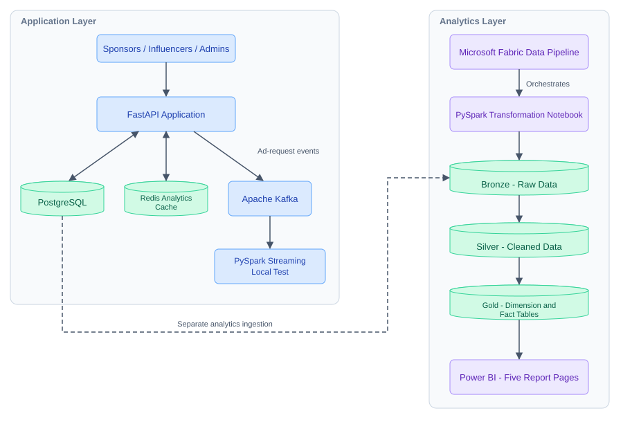
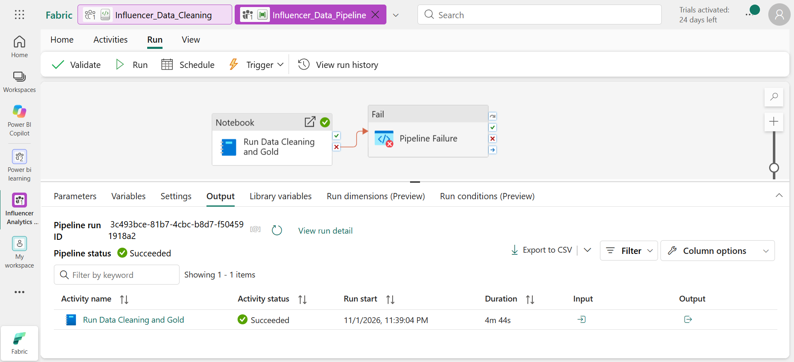
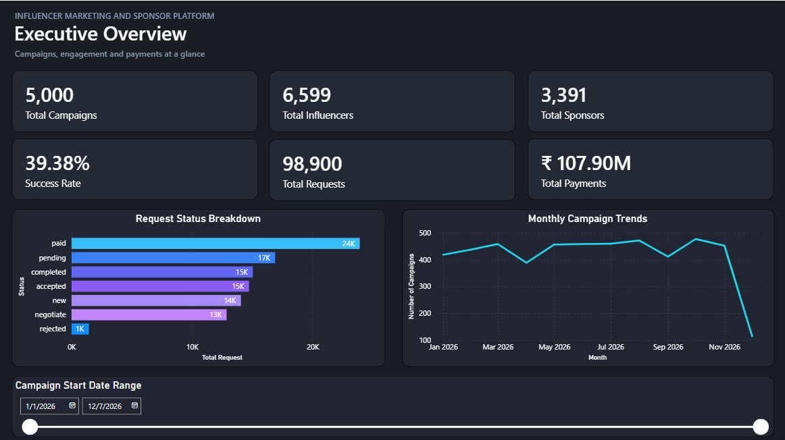
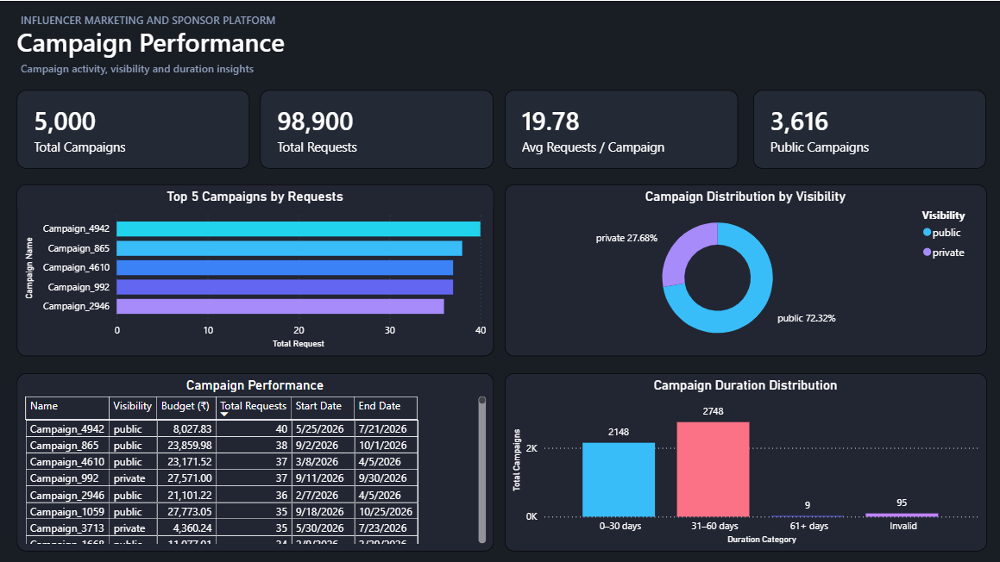
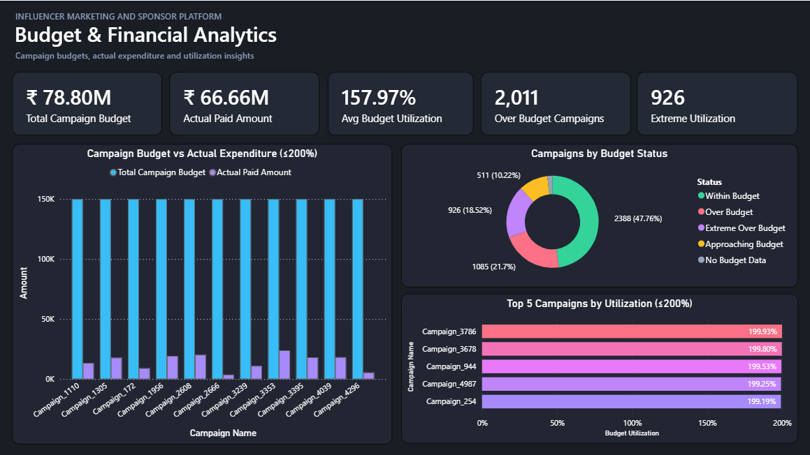
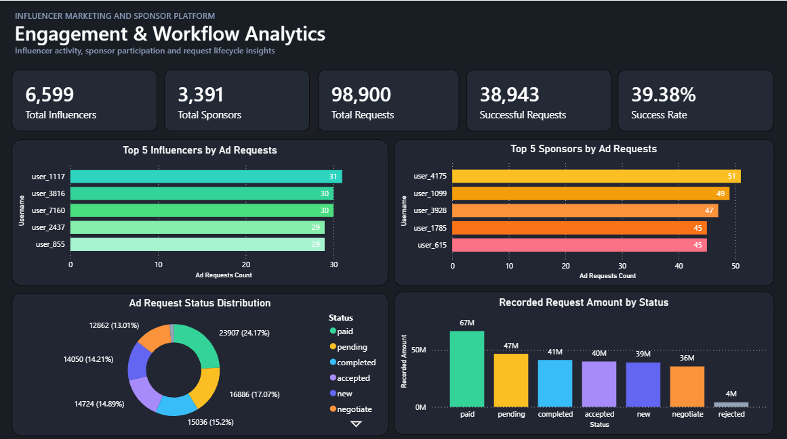
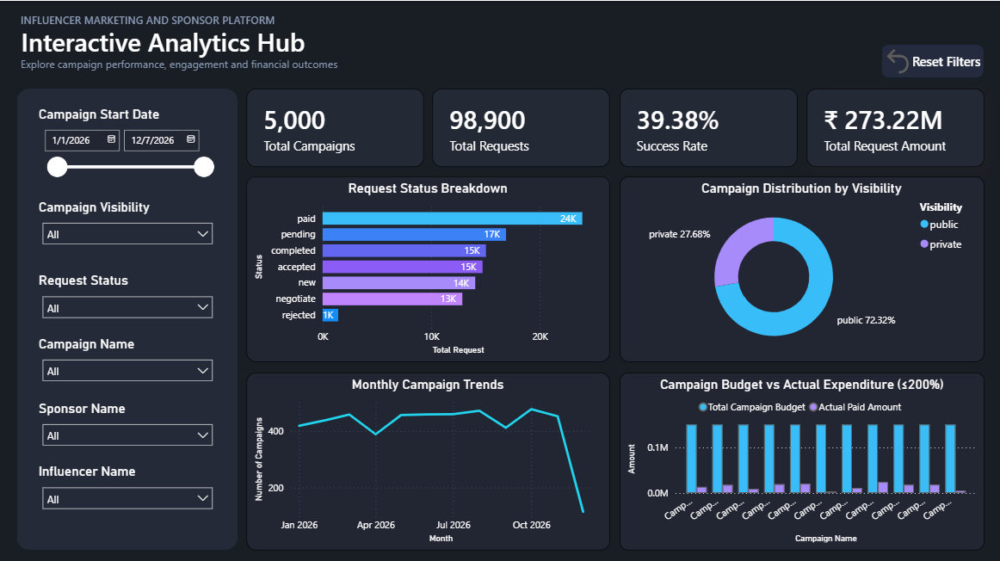
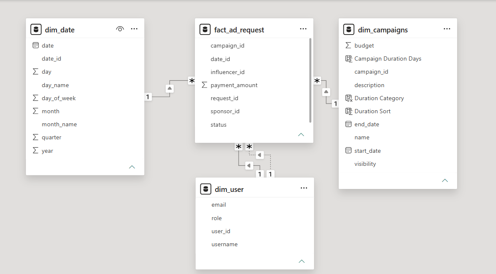

# Influencer Marketing & Sponsorship Analytics Platform

An end-to-end **synthetic-data portfolio project** combining a role-based influencer/sponsor web application, PostgreSQL operational storage, Redis analytics caching, Kafka event streaming, Microsoft Fabric PySpark transformations and pipeline orchestration, and a **five-page Power BI report**.

> **Data and payments notice:** The shared analytics dataset contains synthetic users, campaigns, and sponsorship requests. Payment confirmations are simulated; this project does not process real payments or represent real business revenue.

## Project highlights

| Metric | Value |
|---|---:|
| Campaigns in the analytics dataset | 5,000 |
| Ad requests | 98,900 |
| Influencers | 6,599 |
| Sponsors | 3,391 |
| Power BI report pages | 5 |

*These figures describe the provided synthetic analytics snapshot, not the smaller live operational database.*

## Architecture



The **Kafka local streaming test** and **Microsoft Fabric Lakehouse processing** are separate workflow components; the repository does not claim that Kafka streams automatically feed the Fabric pipeline. Fabric Data Pipeline orchestration covers the notebook execution shown below.

## What's inside

- `api.py`, helper modules, `templates/`, `static/` (where present) — FastAPI application, role-based interfaces, authentication, sponsorship workflows, and analytics.
- `pipeline/` — data loading and migration utilities, Kafka/PySpark local streaming test, and data quality work.
- `fabric/Influencer_Data_Cleaning.ipynb` — Fabric PySpark notebook for cleaning and transforming analytics datasets.
- `data/powerbi/` — synthetic dimension/fact CSV exports and helper-table snapshots.
- `powerbi/marketing_platform_project.pbix` — five-page Power BI Desktop report.
- `docs/screenshots/` — dashboard, data-model, and Fabric pipeline screenshots (upload this folder alongside the README).

## Microsoft Fabric: Data Pipeline orchestration

Created a **Microsoft Fabric Data Pipeline** with a notebook activity (`Run Data Cleaning and Gold`) to orchestrate execution of the PySpark transformation notebook. A recorded pipeline run and its notebook activity **succeeded**; the screenshot shows a **4 minute 44 second** notebook activity duration.

The data-processing workflow uses a Medallion Architecture:

- **Bronze:** raw source data / landing tables.
- **Silver:** cleaning, validation, and transformations in PySpark.
- **Gold:** analytics-ready dimension and fact tables consumed by Power BI.

The pipeline supports repeatable notebook execution. **No recurring schedule is claimed here**; scheduling would require a separately configured trigger.



## Power BI report — five pages

### 1. Executive Overview

Platform-wide KPIs, request status breakdown, monthly campaign trends, and a campaign-start-date filter.



### 2. Campaign Performance

Campaign request rankings, visibility distribution, campaign details, and duration distribution.



### 3. Budget & Financial Analytics

Campaign budgets, simulated paid amounts, utilization, and unusually high utilization patterns. Charts labeled **≤200%** intentionally limit the displayed utilization range; this does not change the underlying records.



### 4. Engagement & Workflow Analytics

Top sponsors and influencers by request count, request status distribution, and amounts recorded against each request status.



### 5. Interactive Analytics Hub

An interactive view with campaign date, visibility, request status, campaign name, sponsor, and influencer slicers; KPI cards; workflow, visibility, trend, and budget visuals; and a reset-filters button.



### Power BI data model

The report uses campaign, user, and date dimensions alongside an ad-request fact table. Sponsor and influencer filtering require distinct treatment because they represent different roles related to the same request.



## Financial metric definitions

**These metrics must not be interpreted as bank transactions or real cash received.** They sum the recorded `payment_amount` field within a synthetic workflow.

| Report metric | Definition | Snapshot shown |
|---|---|---:|
| **Total Payments** (Executive Overview) | Sum of recorded request amounts where `status` is **`paid` OR `completed`**. `completed` means collaboration work is finished but **payment is not yet confirmed**. The label is a historical dashboard label, not actual payments received. | ₹107.90M |
| **Actual Paid Amount** (Financial Analytics) | Sum of recorded request amounts for requests with `status = paid` only; represents **simulated confirmed payments**. | ₹66.66M |
| **Total Request Amount** (Interactive Hub) | Sum of recorded request amounts **across all statuses**, including requests that are not paid. | ₹273.22M |

The Executive Overview's **Total Payments** label is potentially misleading. A more precise future label would be **Paid + Completed Request Amount**; until the PBIX label is changed, use the definition above when interpreting that card.

Request statuses follow this simplified workflow: `new` (created), `pending` (sent, awaiting response), `negotiate` (offer under discussion), `accepted` (collaboration agreed), `rejected` (declined), `completed` (work completed, payment not necessarily received), and `paid` (simulated payment confirmed).

## Known synthetic-data quality limitations

This portfolio dataset includes intentionally or inadvertently inconsistent synthetic records and is **not presented as production-quality financial data**:

- **95 campaigns appear in the “Invalid” duration category** in the uploaded Campaign Performance screenshot. This suggests campaign-duration validation/cleaning was incomplete for the Gold dataset used in that PBIX snapshot. These rows **have not been verified as removed or fixed** in the version shown. Validate the source dates and the duration-classification logic, then rebuild/refresh the Gold tables and report before claiming the issue is resolved.
- Some campaigns show extreme budget utilization (including values above 200%). The report preserves the underlying figures while applying clearly labeled visual filters in selected charts.
- The source dataset is synthetic, and request `payment_amount` values can be populated before a request reaches `paid` status.

## Running the application locally

Prerequisites: Python 3.11, PostgreSQL; Redis via Docker is supported. Kafka is optional for basic application behavior but needed for event streaming tests.

```bash
python -m venv .venv
# Windows: .venv\Scripts\activate
# macOS/Linux: source .venv/bin/activate
pip install -r requirements.txt
```

Copy `.env.example` to `.env` and supply valid `DATABASE_URL` and `SESSION_SECRET` values. **Never commit `.env`.**

```bash
uvicorn api:app --reload
```

`compose.yaml` assumes environment-specific external PostgreSQL and Kafka services; Redis is included. The application and entire integrated pipeline **have not been independently tested end-to-end as part of this GitHub packaging process**.

## Fabric and Power BI reproduction

1. Open `fabric/Influencer_Data_Cleaning.ipynb` in a Microsoft Fabric workspace with a Lakehouse configured for the expected raw tables (`raw_users`, `raw_campaigns`, `raw_ad_requests`).
2. Review the notebook's table names, workspace identifiers, and environment dependencies before running.
3. Configure a Fabric Data Pipeline notebook activity referencing the notebook, or run the notebook manually. The screenshot documents a successful orchestration run, not a published pipeline configuration file.
4. Open `powerbi/marketing_platform_project.pbix` in Power BI Desktop and configure data source credentials/paths if required.
5. Inspect the sample CSVs in `data/powerbi/` to understand the synthetic dimensional model.

## Security and reproducibility

- Local credentials, machine-specific notes, cache files, Spark checkpoints, compiled Python files, and generated Delta/Parquet fragments were excluded from the prepared repository.
- The original local project contained embedded database credentials. The published loader is configured to use `DATABASE_URL` from the environment. **Rotate any credentials that were exposed in older local copies or commits.**
- This is a portfolio/demo project, not a production-hardened payment system.

## Future improvements

- Add repeatable local Docker Compose setup for PostgreSQL, Redis, Kafka, and FastAPI.
- Add tests for authentication, request state transitions, aggregation logic, and combined sponsor/influencer slicer behavior.
- Validate and resolve invalid campaign durations in the source and Gold layer; refresh Power BI afterward.
