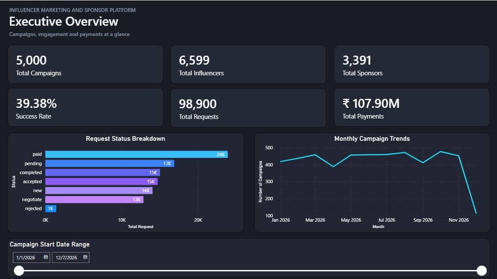
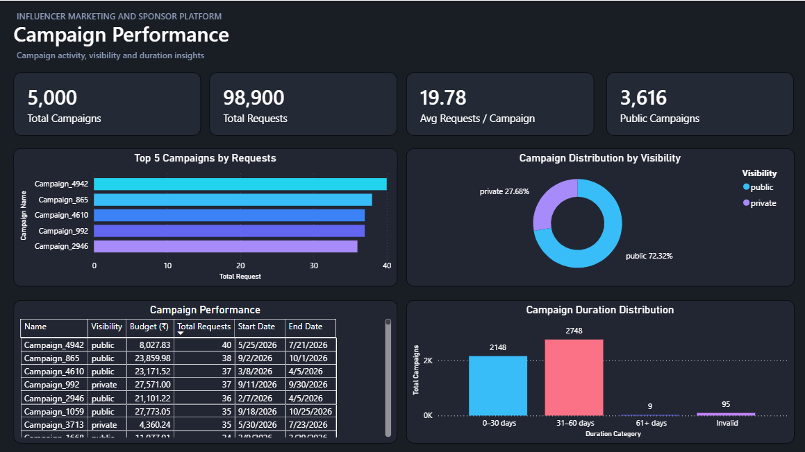
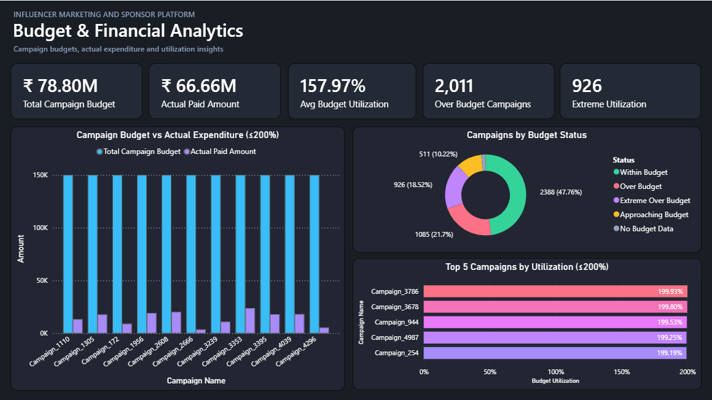
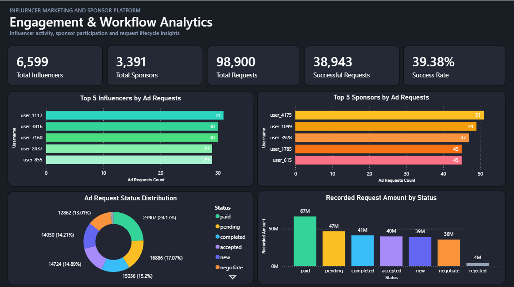
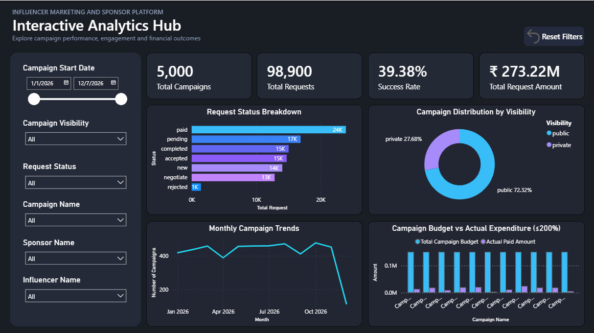
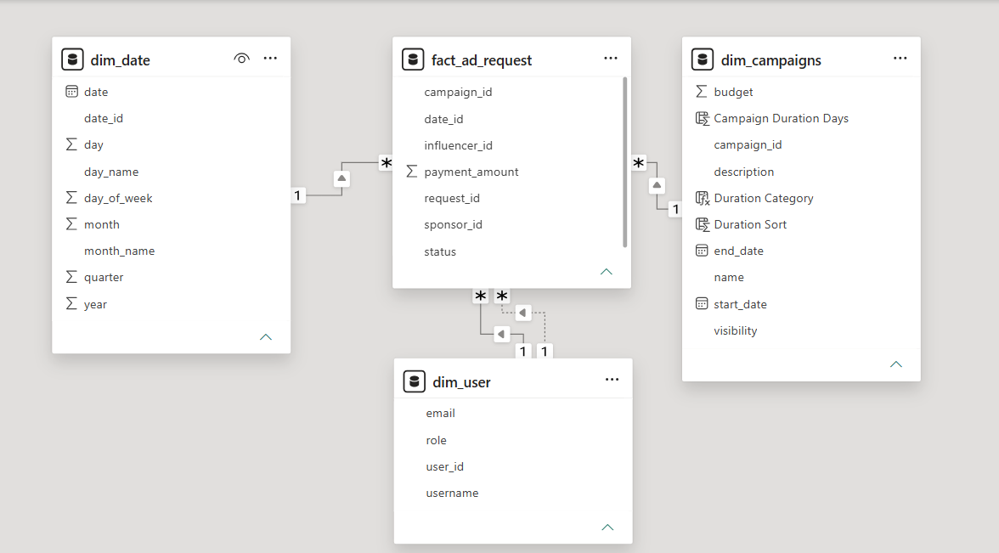
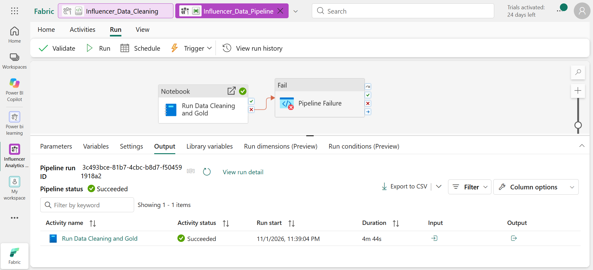

## Power BI Analytics Dashboard

Built a five-page Power BI report over the Microsoft Fabric Gold-layer analytical model to explore campaigns, sponsorship requests, financial outcomes, and engagement workflows. The data shown in these examples is synthetic.

### 1. Executive Overview
Platform-wide KPIs, request statuses, monthly campaign trends, and date-based filtering.

### 2. Campaign Performance
Top-performing campaigns, visibility breakdown, detailed campaign metrics, and duration distribution.

### 3. Budget & Financial Analytics
Campaign budgets, paid request amounts, utilization bands, and campaign-level comparisons. Extreme synthetic utilization values are excluded from selected comparison charts, not from the source data.

### 4. Engagement & Workflow Analytics
Influencer and sponsor engagement, request lifecycle distribution, and monetary values recorded against each request status.

### 5. Interactive Analytics Hub
Multi-slicer exploration by campaign start date, visibility, request status, campaign, sponsor, and influencer; reset-to-default bookmark.

## Data Model

Dimension and fact tables power Power BI reporting. The user table contains separate sponsor/influencer relationships, requiring role-aware filtering for specific measures.

## Microsoft Fabric Pipeline Orchestration

A Microsoft Fabric Data Pipeline invokes the data-cleaning and Gold-layer PySpark notebook. The screenshot documents one successful notebook activity execution; it does not imply that a recurring schedule was configured.

